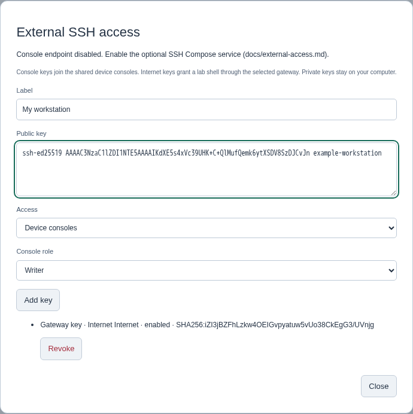
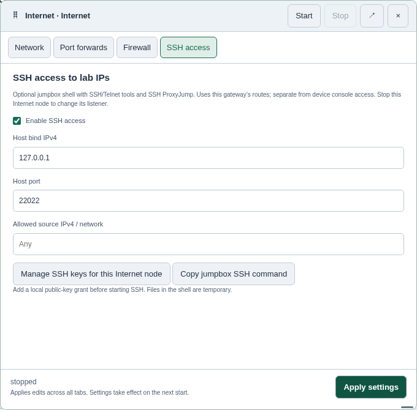

# External SSH consoles and access to lab IPs

[Help index](README.md) · [Consoles](consoles.md) · [Internet gateway](internet.md)

These optional features are available in 0.12.0. Console SSH uses the additional
Compose service below; Internet-node SSH requires the matching helper image.
The device library stays the same.

| Connection | What it provides | What must be running |
| --- | --- | --- |
| External console SSH | The same device console as the browser, including input locks | Core, the optional SSH service and the device; no guest IP or Internet node needed |
| Internet node SSH | A small lab shell with SSH/Telnet tools; also an SSH jump host | That Internet node and reachable guest IP services |

## Enable external consoles

Use the existing Compose configuration with the additional SSH override. Set
these values in `.env`:

```dotenv
WL_EXTERNAL_CONSOLES=1
WL_SSH_BIND=127.0.0.1
WL_SSH_PORT=2222
WL_SSH_SESSION_SECONDS=28800
```

Then build/recreate using your normal overrides plus `compose.ssh.yaml`. For
example, with KVM and Agent:

```sh
docker compose -f compose.yaml -f compose.kvm.yaml -f compose.agent.yaml -f compose.ssh.yaml up -d --build
```

On installations using the standalone Compose command, substitute
`docker-compose` for `docker compose`. Save/stop your devices before recreating
core; this is not a live upgrade. The SSH override builds its own service image
and uses dedicated broker and host-key volumes. It never mounts the Docker socket
or the Agent's state into the SSH service.

The default listener is local to the Docker host. To connect from another
computer, use an SSH tunnel through the host or set `WL_SSH_BIND` to a host LAN
IPv4 address. Key authentication remains required even with `WL_AUTH=0`.
Setting `WL_EXTERNAL_CONSOLES=0` revokes console access when core is recreated;
remove the SSH service if you also want to remove the listener.

## Register public keys

Open **Storage → External SSH access**. Add a label, paste one OpenSSH public
key (for example, the contents of `~/.ssh/id_ed25519.pub`), choose **Device
consoles** and select reader, writer or administrator. Multiple keys are supported.
The list shows fingerprints and **Revoke**. Never paste a private key.

[](https://raw.githubusercontent.com/weblab-network/weblab/main/docs/assets/external-console-keys.png)

*Key registration in a disposable demonstration workspace. Its console endpoint
is disabled here; enable the Compose service as described above to connect.*

With Weblab authentication enabled, only admin manages keys. Console roles have
the same read/input/takeover permissions as the browser. The key is associated
with the corresponding account; account lockout, password change or reset makes
the grant inactive. Revoke and register it again after correcting that account.
An SSH login is its own station: a separate browser logout does not log it out,
and two SSH connections using the same key do not share lock ownership.

Revoking a console key closes its active sessions, normally within a second.
Console sessions also expire after `WL_SSH_SESSION_SECONDS` (60–86400 seconds).
Console host keys persist in the Compose `ssh-host-keys` volume; retain that
volume to avoid changing the host identity on upgrades. The settings show its
fingerprint after the SSH service registers with core.

## Connect to a console

On the Docker host, using a registered client key:

```sh
ssh -p 2222 console@127.0.0.1          # list consoles and select a node ID
ssh -p 2222 console@127.0.0.1 list     # list only
ssh -t -p 2222 console@127.0.0.1 console r1
```

Use the actual persistent node ID from the list. The inspector's **Copy console
SSH command** uses the selected node and localhost for a loopback binding, or
the browser's server hostname for a LAN binding; adjust the hostname if using a tunnel or a different externally reachable address.
The node must already be running. Only the console menu/attach commands are
accepted; this endpoint provides no core shell, SCP/SFTP or TCP forwarding.
The Inspector button appears for routers, switches and PCs. For an Internet
node's shell, use **Copy jumpbox SSH command** in its SSH settings instead.

Normal keys go to the managed console. **Ctrl+]** opens its control menu:

| Key | Action |
| --- | --- |
| `l` / `u` | Lock / unlock input |
| `t` | Take over, or request control from the owning admin |
| `a` / `d` | Allow / deny a pending request |
| `c` | Cancel your pending request |
| `q` | Disconnect, leaving the node running |
| Ctrl+] again | Send a literal Ctrl+] to the device |

Other keys leave the menu without sending input. Takeovers that require
confirmation ask for `y`. Reader sessions cannot input or control locks. A stopped
or restarted node ends the connection; reconnect explicitly. Output and scrollback
come from the existing shared wrapper. Window resizing does not reconfigure the
shared device PTY or override another station's terminal size.

## Enable the Internet node's SSH shell

Pull the matching helper on the Docker host and select it with
`WL_INTERNET_IMAGE=ghcr.io/weblab-network/weblab-internet:0.12.0`:

```sh
docker pull ghcr.io/weblab-network/weblab-internet:0.12.0
```

For source deployments, build the updated helper instead:

```sh
docker build -f packaging/internet/Dockerfile -t weblab-internet:dev .
```

For that local build, use `WL_INTERNET_IMAGE=weblab-internet:dev`. Changing core’s
environment requires recreating core with the same volumes; save and stop the lab
first. In the Internet node settings, open the **SSH access** tab. Enable it, choose a
host bind address/port (default `127.0.0.1:22022`) and, for LAN bindings, an optional
allowed source IPv4/CIDR. Leave source blank for localhost. Stop only this
Internet node to apply listener changes, then start it again.

The Inspector also has an **Enable SSH access** checkbox and an **SSH access
settings** shortcut. Toggling the checkbox opens the SSH tab with the change
staged for review; choose **Apply settings** to save it. Closing the window
without applying discards those edits. The checkbox is disabled while this
Internet node is running.

[](https://raw.githubusercontent.com/weblab-network/weblab/main/docs/assets/internet-ssh-settings.png)

*The SSH access tab configures the gateway shell; it is separate from shared
console SSH. Click either screenshot for full size.*

Use **Manage SSH keys for this Internet node** to register a key with **Internet
SSH shell** access. These grants are separate from console grants: a console
reader key does not grant a shell. With no local grant, SSH stays inaccessible
and the settings report it as unconfigured. Adding/revoking keys synchronizes
without restarting NAT, normally within a few seconds; changing the grant set
disconnects existing shell/jump sessions on that gateway so revocation is effective.

If login fails with `Permission denied (publickey)`, check the key's **Access**
selection in Storage. **Device consoles** authorizes `console` on port 2222;
**Internet SSH shell** authorizes `lab` on the selected Internet node's port
(default 22022). To use both, register the same public key in both scopes.
Opening **Manage SSH keys for this Internet node** preselects the right scope
and node. An “SSH unconfigured” status means no valid key is registered there.

```sh
ssh -p 22022 lab@127.0.0.1
# Inside the lab shell:
ssh admin@10.0.10.1
telnet 10.0.10.2
```

The shell is non-root. Routes and interface configuration remain managed by the
Internet node settings. Its outbound connections are limited to the connected
lab subnet and configured return networks, excluding the gateway itself and
Docker/host uplink. The guest must have the requested service, credentials and
a return route to the Internet node's lab IP. This works with any reachable
guest IP service, regardless of device vendor.
Guest SSH/Telnet sessions use the guest's own authentication and are independent
of Weblab's shared-console input locks.

Alternatively connect directly from your workstation through the jump host:

```sh
ssh -J lab@lab-host:22022 admin@10.0.10.1
```

Use `~/.ssh/config` to specify different keys for the jump host and guest. Guest
authentication and host-key checks remain on the workstation; no private key
needs to be copied into the shell. SSH agent forwarding, remote forwards and
X11 forwarding are disabled. Local TCP forwarding/ProxyJump is subject to the
same lab-only destination policy as shell programs.

The internal SSH helper shares the gateway's network but has separate processes
and storage, no network-administration capability, and no console-broker access.
An SSH helper failure is reported separately from NAT/DNS. Stop/start only that
Internet node to recover it. Weblab's normal Docker logs identify the internal
`wl-cloud-…-ssh` service if diagnosis is needed.

## Saving and portability

Keys and access grants belong to this installation, under `.external-access`
in the core data directory; they are not included in topology JSON or saved ZIP.
Requested Internet SSH settings are exported, but importing a lab does not
register anyone's key. Register local grants for that node on the new installation.

Gateway SSH host identities persist in small Docker volumes named
`wl-ssh-<workspace-owner>-<node-hash>`, outside saved lab artifacts. A copied lab on
a different installation gets a new host key. These volumes are retained after
node removal; delete an unused one explicitly only when its identity is no longer
needed. User shell files and installed packages are temporary; required clients
are built into the image. This shell is not a persistent Linux workstation.
